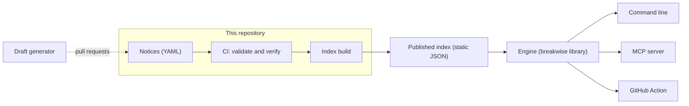

# Breakwise architecture

This document describes how Breakwise fits together: its parts, how data moves between them, and why it is built this way.
It covers what exists today and the plan for what comes next, marked **Built**, **Next** (phases 1 and 2 of the [roadmap](#roadmap)) or **Planned**.

For a part that is built, the code is the reference: if this document disagrees with it, fix the document.
For a part that is planned, this document is the reference until the code exists.

## Goals

- **Upgrades without surprises.** Before a developer upgrades a Python dependency, they learn what breaks, where in their code, and how to fix it.
- **Fixes people can trust.** Every notice has examples that run on real releases, and every automatic fix is a deterministic code transformation that is tested.
- **Open by design.** The registry is open data, and the tools are open source. Everything runs on the developer's machine or in their own CI. No server ever sees anyone's code: the registry is published as static files, and the package bundles a copy for offline use.
- **One engine for people and agents.** The same library serves a command line, a GitHub Action and an MCP server for coding agents.

## Non-goals

- **Other ecosystems, for now.** Breakwise covers Python packages on PyPI. The format names the ecosystem so that this can change later, but nothing else is built for it.
- **A hosted service.** There are no accounts, and no server ever processes anyone's code.
- **Merging.** Breakwise proposes changes in pull requests. People merge them.
- **Security advisories.** Vulnerabilities belong in OSV and the GitHub Advisory Database. Breakwise covers changes that break working code.

## Principles

1. **The registry is the product.** Every tool is a view of the same data, so improving a notice improves every tool at once.
2. **Rules before AI.** A change that a rule can fix is fixed by a rule. AI is used only where a person would otherwise have to decide, and to draft notices for people to review. AI never marks a notice as verified, and its changes are proposed only after the project's tests pass.
3. **Verified against real releases.** Claims about versions are checked by installing those versions from PyPI, not taken from changelogs alone.
4. **Safe by default.** Reports change nothing. A fix reaches the code only as a diff the user accepts, or as a commit in a pull request that people review. The engine never runs code from notices on a user's machine: only CI runs notice examples.
5. **Local and private.** Breakwise reads code only where the user runs it, and it sends no telemetry. AI features stay off until the user turns them on and chooses a provider.
6. **Reproducible.** Inputs are pinned, and the same inputs give the same output. Every report names the commit the index was built from, so any result can be traced to the exact notices behind it.

## Overview



| Part | Role | Status |
| --- | --- | --- |
| Notice format | Describes one breaking change, with tested examples | Built (v0.2) |
| Validator | Checks every notice without running code | Built |
| Verifier | Runs every example on real releases from PyPI | Built |
| Index | Publishes the registry as static JSON for clients | Next |
| Engine analysis | Finds the code that a notice affects | Next |
| `explain` | Shows a notice offline, from the notices bundled with the package | Built (0.1.0) |
| `scan` | Reports the code that an upgrade breaks | Next |
| MCP server | Gives coding agents the registry and the engine | Planned |
| Engine fixes, `fix` and `upgrade` | Rewrite the affected code, alone or as a two-step upgrade | Planned |
| GitHub Action | Comments tested fixes on Dependabot and Renovate pull requests | Planned |
| Draft generator | Drafts notices from API diffs and changelogs | Planned |
| Agent | Proposes fixes for notices that need a person | Planned |

## Registry

### Notices (Built)

- A notice is one YAML file at `notices/<ecosystem>/<package>/<id>.yaml`. [docs/notice-format.md](notice-format.md) defines every field.
- Each format version has its own JSON Schema in `schema/`. A released schema is never edited: changes go into the next version, with an entry in the changelog.
- The tools accept only the latest format version. The pull request that releases a version moves every notice to it.
- `breaks_in` is the first release in which the old code fails, and `works_since` the first in which the new code runs, pre-releases included. A notice leaves out `works_since` when that release is unknown, and tools then treat its fix as one that can't come before the upgrade.
- IDs are permanent. A wrong notice is corrected and gets a new `modified` date. A format version after v0.2 will add a `withdrawn` field for a notice that should never have existed, so that its ID keeps a meaning.

### Checks (Built)

- The **validator** reads every notice as plain YAML and checks it against the schema and the rules: location, ID, dates and versions, that the examples compile and use the right names, and that the README example matches its notice.
- The **verifier** installs real releases with uv, with dependencies as they were a day after each release, and runs the examples on Python 3.12 in a separate process, with no secrets and with network calls blocked and recorded. The block stops accidents but is not a security boundary, so CI also runs the job with read-only permissions, and pull requests from outside contributors need a maintainer's approval. It also checks that `breaks_in` and `works_since` are the first such releases. For a rename, one probe for each release resolves the paths with `pkgutil.resolve_name`, in the same sandbox as the examples: `rename.from` where `example.before` runs and not on `breaks_in`, `rename.to` where `example.after` runs, and every callable of a renamed keyword argument where an example runs. The same probe reads the signatures of those callables. Each run also checks the latest release after `breaks_in` that accepts the Python of the examples, as it checks `breaks_in`, so the result depends on when it runs.
- The tools themselves run on Python 3.12, 3.13 and 3.14. Examples run on 3.12 only, because old releases of a package may not install on a newer Python.
- Every pull request has four required checks: the validator with the tests and linters of the tools, the tests on Python 3.13 and on 3.14, and the verifier. On a pull request, the verifier runs the notices it changes, or every notice when the tools change. It runs every notice on each push to `main` and every week, so that a yanked release or a library that changed course is noticed.

### Index (Next)

Clients never read YAML from git. On every push to `main`, CI builds an index and publishes it:

- `tools/build_index.py` writes `v1/manifest.json` and one file per package, `v1/pypi/<package>.json`, with that package's notices as JSON.
- The manifest lists every package with its aliases, its number of notices and the SHA-256 of its file, and records the commit the index was built from. A client downloads the manifest, then every file whose SHA-256 differs from its cache, so the host never learns which packages a project uses. The registry is small, so this costs little.
- Each notice keeps its `status`, so clients can tell drafts from verified notices.
- The build is deterministic: keys and files are sorted, and the only date it records is the commit's.
- A separate job publishes the files with GitHub Pages and attaches a build provenance attestation, so anyone can check that a file came from this repository's workflow. That job has only the permissions publishing needs, and it runs nothing from pull requests.
- The index has its own format version in its path (`v1`). A change that breaks clients gets a new path, and the old one stays available.
- The URL of the index is part of the public interface. It should be on the project's own domain before the first release that downloads it, so that the host can change later without breaking installed clients.
- Every file carries the data license (CC BY 4.0) and the attribution text, and the tools show the attribution in their reports.

## Engine (Next)

The engine is the `breakwise` package in `src/breakwise/` (Apache-2.0), published to PyPI with Trusted Publishing and attestations. Every interface is a thin layer over it. It works in five steps:

1. **Project.** Find the packages the project uses and their versions. The sources, from most to least exact, are lock files (`pylock.toml` from PEP 751, `uv.lock`, `poetry.lock` and `pdm.lock`), pinned requirements files, the installed environment, and the ranges in `pyproject.toml`. Each version remembers its source, so reports can say how sure they are. An alias counts as the package it ships, so a project on `pydantic-ai-slim` gets the notices for `pydantic-ai`. When only a range is known, the engine takes the lowest version that the range allows, and the report says so.
2. **Plan.** Decide the target versions: given by the user, read from the other side of a pull request (the lock files of its base and its head), or the latest release. Pre-releases are targets only when the user asks for one or the project already uses one. A notice applies when `current < breaks_in <= target` in PEP 440 order. If `works_since <= current`, its fix can be applied before upgrading. A notice without `works_since` waits for the upgrade.
3. **Analyze.** Find the code that each applicable notice affects:
   - A text pre-filter skips files that never mention the top-level module of the notice's names, such as `pydantic_ai`, so that large projects stay fast.
   - LibCST parses the remaining files without losing their formatting, and its qualified-name metadata resolves imports and aliases, such as `from pydantic_ai.models.openai import OpenAIModel as Model`.
   - Every finding has a confidence. It is **certain** when the code resolves to the notice's dotted path, **possible** when only part of it matches, such as a method called on an object of unknown type, and **dynamic** for `getattr`, `**kwargs` and other code that can't be resolved statically.
   - Later, type inference from a type checker turns possible findings on method calls into certain ones.
4. **Fix.** LibCST transforms rewrite imports, attribute paths and, from format v0.2, the keyword arguments of the callables that a notice lists. They keep formatting and comments, give the same result when run twice, and touch only certain findings of `verified` notices. Draft notices appear in reports, marked as drafts, but are never applied. If the new name is already imported, they reuse it.
5. **Report.** Text for people, JSON with a documented and versioned schema for tools, SARIF for GitHub code scanning, and Markdown for pull request comments. Each finding names the notice, the file and line, the confidence and the fix.

Analysis is static: the engine never imports or runs the project's code. Only the test step of an upgrade runs the project's own test command.

### Two-step upgrades

Notices record `works_since`, so the engine can split an upgrade in two:

1. While the project still uses the old release, apply every fix whose `works_since` is not later than the current version, and run the tests. People can merge this step on its own.
2. Upgrade the dependency, and apply only the fixes that could not come earlier.

Each step is smaller and tested, and a failure points to one cause.

### Notices test the engine

For every notice with an automatic fix, applying the fix to `example.before` must produce `example.after`. The engine's tests run this on every notice in the registry, so each new notice is also a new test case, and a fix that drifts from its notice fails CI.
This is also a rule for authors, which format v0.2 adds to [docs/notice-format.md](notice-format.md): for a `rename`, `example.after` is exactly `example.before` with the rename applied, and nothing else.

## Interfaces

### Command line (Next)

- `breakwise explain BW-2026-0001` shows a notice. It came first, in release 0.1.0, and works offline from the notices bundled with the package.
- `breakwise scan` reports the code that an upgrade breaks and changes nothing. Its exit code says whether anything applies, so CI can use it as a check.
- `breakwise fix` (Planned) shows the diff of the certain fixes, then writes it when the user confirms or passes `--write`.
- `breakwise upgrade pydantic-ai` (Planned) runs the two-step upgrade, with the project's tests after each step.
- Settings live in `[tool.breakwise]` in `pyproject.toml`: paths to skip, notices to ignore with a reason, and the test command.

### MCP server (Planned)

Coding agents increasingly do upgrades themselves. With an MCP server, any agent can use verified notices instead of guessing from changelogs.

- `breakwise mcp` runs over stdio and ships in the same package, as the `breakwise[mcp]` extra.
- Its tools are `find_notices` for a package and a version range, `get_notice` and `scan`. Once fixes exist, `plan_fixes` returns diffs, and the agent applies them through its own approval flow. The server itself never writes files.
- Each notice is also a resource, at `breakwise://notices/<id>`.
- It comes right after the first release of `scan`, because its read-only tools need nothing more from the engine.

### GitHub Action (Planned)

- It lives in its own public repository, `breakwise/action`, because GitHub Marketplace needs an action's metadata at the root of its repository. It installs a pinned release of the `breakwise` package and calls the command line.
- It runs on pull requests that change lock files or requirements, such as the ones that Dependabot and Renovate open.
- It uses two jobs, so that code from the pull request never runs with a write token:
  1. **Analyze**, with read-only permissions: compute the version changes between base and head, apply the fixes, run the project's tests, and save the report and the diff as an artifact.
  2. **Report**, with `pull-requests: write` on that job only: post one comment and keep it up to date. It runs nothing from the repository.
- Workflows that Dependabot starts get a read-only token by default, but the `permissions` key can raise it, as GitHub documents. A pull request from a fork can't get a write token, so for forks the Report job runs from `workflow_run`.
- By default, the comment holds the report, the diff and the `breakwise fix` command that makes the same change locally. It doesn't use review suggestions, because GitHub allows them only on lines that the pull request changed, and a Dependabot pull request changes only lock files.
- A push mode is optional: a commit on the pull request's branch, or a separate pull request. It needs the user's own GitHub App or token, because a commit pushed with the workflow's `GITHUB_TOKEN` starts no workflows, so CI wouldn't run on it. Breakwise hosts no service for this. Dependabot and Renovate stop updating a branch once someone else commits to it, so a separate pull request often fits better.
- It never approves or merges.

### Agent (Planned)

For notices that need a person (`removal`, `signature` and `behavior`), the agent drafts the change from the notice's instructions and examples, the findings and the code around them.
It works with any model provider through one interface, and the user chooses the provider and supplies the key.
Its change is proposed only after the project's tests pass, and the pull request says that the agent wrote it, so that reviewers look closely. It is off by default.

## Authoring (Planned)

The registry grows only as fast as notices are written and verified. The draft generator speeds that up without lowering the bar:

1. **Watch.** A scheduled workflow notices new releases of the packages that the registry follows.
2. **Compare.** griffe compares the public API of the two releases and lists removed names and renamed or changed parameters.
3. **Read.** The changelog and release notes for the same range, from official sources only.
4. **Draft.** A model classifies each change and writes a draft notice with examples and references.
5. **Verify.** The verifier runs the drafted examples on real releases. Drafts that fail are dropped or corrected.
6. **Review.** Passing drafts open as pull requests with status `draft`. A maintainer checks the sources and sets `verified`. The generator never does.

It is a maintainer tool in `tools/`, not part of the package that users install.

## Repository layout

```text
notices/          the registry (CC BY 4.0)
schema/           JSON Schemas: one per notice format version, and the index format
docs/             the notice format, this document and guides
src/breakwise/    the engine, the command line and the MCP server (Apache-2.0)
tools/            registry tools: validate, verify, build the index and draft notices
tests/            tests for src/ and tools/
```

When the engine starts, the notice model that the validator and the verifier share moves to `breakwise.notices`, so that the registry tools and the engine read notices the same way.

## Cross-cutting concerns

- **Security.** For clients, the index is untrusted input: the engine checks every file against the manifest's SHA-256 and the index schema before using it. The SHA-256 only shows that a file matches the manifest it came with, not that both came from this repository: whoever controls the host could replace both. The build provenance attestation shows where they came from, and the engine verifies it before phase 4, when automatic fixes start writing to people's code. Dependencies are pinned with hashes, actions by commit SHA, and releases are published with Trusted Publishing and attestations, only after the tagged commit passes every check.
- **Versioning.** The notice format may change before 1.0, with every change in its changelog. From 1.0, a change that breaks readers needs a new major version. The index versions its path, and the engine follows semantic versioning, including the schema of its JSON output.
- **Offline use.** Each release of the package bundles the notices as they were at release time. Once the index is published, the engine refreshes them from it at most once a day, and falls back to its cache or the bundled copy when it can't.
- **Performance.** Each file is parsed once, files are processed in parallel, and results are cached by file content, so a second scan of an unchanged project is almost instant.
- **Quality.** The engine keeps the bar of the registry tools: ruff, mypy in strict mode, full line and branch coverage, and mutation testing for the transforms, plus before-and-after files for every fix.
- **Attribution.** The notices are CC BY 4.0, so every report credits the Breakwise registry and links to the notice.

## Decisions

| Question | Decision | Instead of | Why |
| --- | --- | --- | --- |
| Which format versions do the tools read? | Only the latest, and a released schema never changes | Several versions side by side | One reader to maintain, and the release pull request moves every notice forward |
| What do `breaks_in` and `works_since` mean? | The first releases in which the old code fails and the new code runs, pre-releases included, checked on real releases | Stable releases only | Upgrades to a pre-release are covered too |
| Which Python runs the examples? | 3.12, while the tools run on 3.12 to 3.14 | The newest Python | Old releases may not install on a newer Python |
| How do clients get notices? | A static index on GitHub Pages | An API server | No server to run or pay for, and it is cacheable and easy to mirror |
| How does a client keep a project private? | It downloads every changed file of the index | Only the files for its packages | The host never learns which packages a project uses |
| How does the engine trust the index? | The manifest's SHA-256 now, and the build attestation before phase 4 | HTTPS alone | Automatic fixes write to people's code, so their data must provably come from this repository |
| How is code analyzed and rewritten? | LibCST | `ast`, regular expressions | It keeps formatting and comments, and it resolves qualified names |
| What is fixed automatically? | Certain findings of `verified` `rename` notices | Every match, or drafts | A wrong fix costs more trust than a missed one |
| Where is AI used? | Notices that need a person, and drafting notices | Every fix | Rules are reproducible and testable |
| Where does the Action live? | Its own repository | This repository | GitHub Marketplace needs `action.yml` at the repository root |
| How does the Action deliver fixes? | One comment with the report, the diff and the `breakwise fix` command. Pushing is optional and uses the user's own App or token | Review suggestions, or pushing by default | Suggestions work only on lines that the pull request changed, and a commit pushed with `GITHUB_TOKEN` starts no CI |
| How are keyword renames expressed? | `rename` with `keyword_of` (format v0.2) | A new notice type | Tools find every automatic fix under one type |
| Can a `rename` have `instructions`? | No, from format v0.2 | Optional instructions | A rename must be a fully automatic fix |
| How is an upgrade applied? | In two steps when `works_since` allows | One change | Smaller tested steps and clearer failures |

## Roadmap

| Phase | Delivers | Done when |
| --- | --- | --- |
| 0. Foundation | Format v0.1, the validator, the verifier and CI | Done: BW-2026-0001 passes every check |
| 1. Registry | A first release on PyPI with `breakwise explain`, then format v0.2, the pydantic-ai V2 notices (#5) and the published index | `pip install breakwise` gives `breakwise explain`, and the index lists every pydantic-ai V2 notice |
| 2. Scan | The engine's project, plan and analysis steps, and `breakwise scan` (#6) | On a sample project, `scan` reports every line that pydantic-ai 2.0 breaks |
| 3. MCP | The MCP server with read-only tools | An agent finds and explains the notices for an upgrade |
| 4. Fix | Rename and keyword fixes, `breakwise fix`, `plan_fixes`, and checking the index attestation | Every notice's fix turns `example.before` into `example.after` |
| 5. Action | `breakwise/action` on GitHub Marketplace | A Dependabot pull request for pydantic-ai gets a comment with a tested fix |
| 6. Scale | The draft generator and the agent | A new release of a followed package gets draft notices within a day |

Writing notices is ongoing work, not a phase. Notices for LangChain and the OpenAI Python SDK start after phase 1 and continue alongside the other phases, and the draft generator in phase 6 speeds them up.

PyPI can't reserve a name, and this document makes the name public, so phase 1 started with a small but real release, 0.1.0: the package bundles a copy of the notices, and `breakwise explain` works offline. The index must have its final URL before the first release that downloads it.

## Looking further

- **Warnings before the break.** A `deprecated_in` field would let the engine warn while the old code still works, long before an upgrade.
- **Migrations in steps.** Links between notices would describe migrations that span several releases.
- **Other tools.** Because the index is public and stable, Renovate, Dependabot, editors and other agents can show notices without running Breakwise.
- **A benchmark for agents.** Every verified notice is a real upgrade task with a tested answer, so the registry can measure how well coding agents handle upgrades.
- **Other ecosystems.** The project, plan and analysis steps sit behind small interfaces, so an ecosystem such as npm could be added later without changing the rest.

## Open questions

- How far type inference should go, and which type checker it should rely on.
- Whether a notice should be able to say that its new code works on every release the verifier can install, instead of leaving out `works_since`.
- How the registry should handle a library that adds a removed name back. The weekly verification notices it, and the notice then needs a decision by a person.
- When the index needs a mirror.
